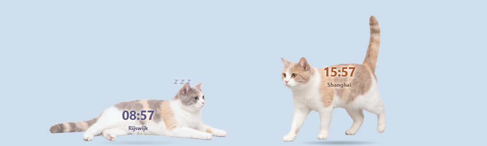

# Cat Clock 🐈🐈

Two cats live on your desktop and show the time in two cities: one cat for you, one for the person far away.
They walk, nap when their person sleeps, greet each other, and remind you when it's time to call. Windows + macOS.

两只猫住在你的桌面上，各自显示一个城市的时间：一只是你，一只是远方的那个人。
它们会走路，主人睡觉时它们也睡觉，会互相打招呼，到时间还会提醒你们通话。支持 Windows 和 macOS。



## What it does · 功能

- **Two cities, two cats** · 两个城市，两只猫. Each cat wears its city's time. Outside its person's awake hours it lies down and sleeps (z z z).
- **Alive** · 会动. They walk, run, rest and lie down. Click a cat: it hops and meows. Rub it with the mouse: purr and hearts. Drag it anywhere; it stays where you drop it.
- **Together** · 一起玩. They greet nose to nose, cuddle up next to each other, and chase each other when one gets the zoomies. They never walk through each other.
- **Call reminders** · 通话提醒. Set reminders in either city's time. The cat runs to the middle of the screen, chimes and meows until you click Stop (or "5 min" to snooze).
- **Out of the way** · 不挡操作. Clicks go straight through to your apps, except on the cats.

Double-click a cat (or click the tray / menu-bar icon) for settings: reminders, cities and time zones, awake hours, which cats, size, sound, walking.
双击猫（或点击任务栏/菜单栏的小图标）打开设置：提醒、城市和时区、醒着的时间、显示哪只猫、大小、声音、走动。

## Install · 安装

Download the latest installer from [Releases](../../releases).

- **Windows**: run the `-setup.exe` (or the `.msi`). The installer is not code-signed, so Windows may show "Windows protected your PC": click *More info → Run anyway*.
- **macOS**: open the `.dmg` and drag **Cat Clock** to Applications. The app is not notarized by Apple, so the first time you open it, go to *System Settings → Privacy & Security → Open Anyway*. If macOS says the app is "damaged", run `xattr -cr "/Applications/Cat Clock.app"` in Terminal once.

从 [Releases](../../releases) 下载最新安装包。Windows 运行 `-setup.exe`（如果出现"Windows 已保护你的电脑"，点"更多信息 → 仍要运行"）；macOS 打开 `.dmg`，把 Cat Clock 拖进"应用程序"。第一次打开时，到"系统设置 → 隐私与安全性"里点"仍要打开"。

### Your own meow sounds · 用自己的猫叫声

The app makes its own meow sound. To use real recordings, put WAV files named `meow-fawn-1.wav`, `meow-fawn-2.wav`, … or `meow-lilac-1.wav`, … into a `sounds` folder next to the settings file and restart the app:

- Windows: `%APPDATA%\com.catclock.app\sounds\`
- macOS: `~/Library/Application Support/com.catclock.app/sounds/`

程序自带合成的猫叫声。想用真实录音的话，把 `meow-fawn-1.wav` 这样命名的 WAV 文件放进上面的 `sounds` 文件夹，然后重启程序。

## Build from source · 从源码构建

Needs [Node.js 22](https://nodejs.org) and [Rust](https://rustup.rs) (plus the [Tauri prerequisites](https://tauri.app/start/prerequisites/) for your system).

```bash
npm ci
npm run check      # type check + tests
npm run dev        # run the app
npm run build      # make an installer in src-tauri/target/release/bundle
```

How it works: one transparent, always-on-top window covers the screen's work area. The cats are drawn on a canvas, and the window lets clicks through everywhere except on a cat's pixels. Code: `src/` (plain JavaScript modules: `cat.js` one cat, `pair.js` the two together, `core.js` time zones and reminders, `panel.js` settings) and `src-tauri/` (Rust shell: settings file, tray, windows).

## Credits · 致谢

- Cat pictures: made by the project author with Google Gemini.
- Purr sound: [Freesound #639255](https://freesound.org/s/639255/), a British Shorthair purring, CC0 (public domain).
- Built with [Tauri](https://tauri.app).

## License

Code: [MIT](LICENSE). The cat pictures in `src/assets/` are included for use with this app.
